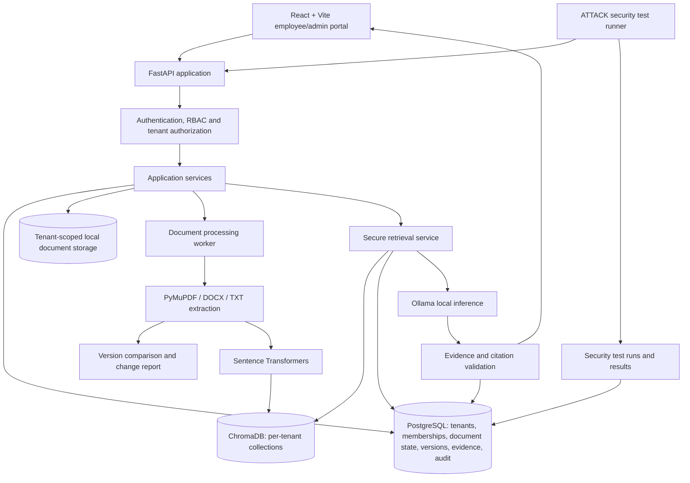
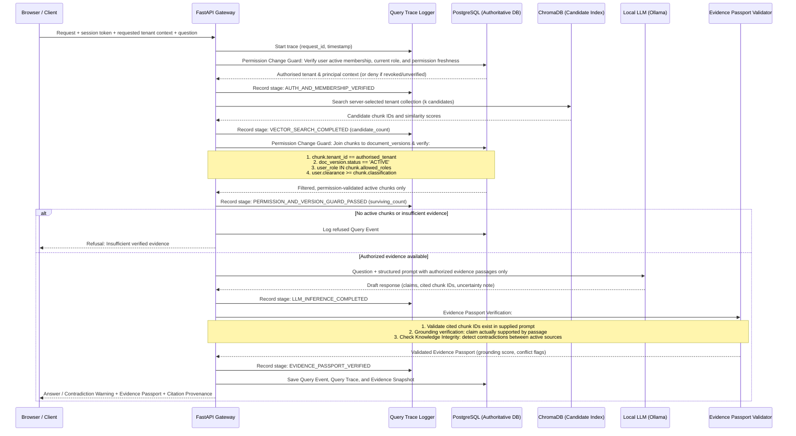
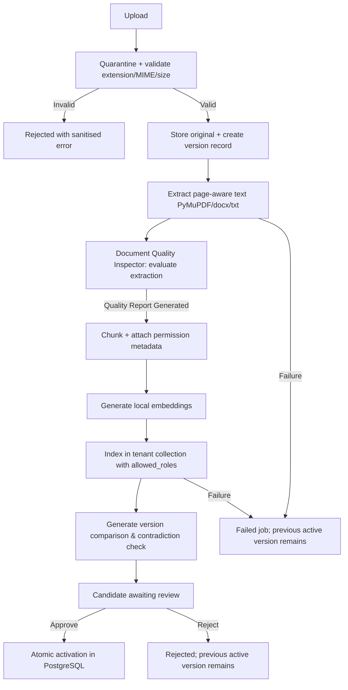

# NEXUS — System Architecture

**Product:** Enterprise Knowledge Intelligence & Assurance Platform  
**Problem statement:** PS-04 — Centralised Multi-Client Knowledge Chatbot  
**Delivery target:** 24-hour deployment-oriented MVP, with an explicit production-hardening path  
**Architecture status:** Proposed baseline for implementation; validate deployment and data-residency assumptions with VLOOKUP before any real-client data is used.

---

## 1. Product intent & Strategic Positioning

NEXUS is not positioned as a generic RAG chatbot, nor as a blind replacement for Microsoft Azure AI Search, AWS Bedrock, or Glean. Those platforms possess massive infrastructure, yet real-world enterprise deployments face persistent, unresolved operational, security, and trust barriers:
- **Permission synchronization lag** (indexes reflecting revoked ACLs for hours/days).
- **Residual hallucinations & unsupported claims** despite retrieval.
- **Outdated, conflicting, and contradictory policies** co-existing without clear authority.
- **Silent data extraction corruption** (broken tables, scrambled layouts, lost context).
- **Permission leakage in vector chunking** (chunks stripped of document-level classifications).
- **Lack of granular, defensible proof** for generated answers.

### NEXUS Core Philosophy
> **"NEXUS doesn't just retrieve enterprise knowledge. It continuously checks whether that knowledge is accessible, current, consistent, and sufficient to answer."**

NEXUS differentiates itself through **Six Core Pillars of Verifiable Knowledge**:

1. **Permission Change Guard:** Real-time query-time verification of user access. Chunks carry granular permission metadata (`allowed_roles`, `classification`). Stale index entries are detected and denied before context reaches the LLM.
2. **Evidence Passport (Primary Trust Anchor):** Every factual claim is bound to an exact source passage, document version, and page number with verifiable grounding checks. Refusal occurs automatically when evidence is insufficient or unverified.
3. **Knowledge Integrity Engine:** Automated version supersession, authority hierarchy (e.g. Official Policy outranking Informal Notes), and contradiction detection between co-existing active documents.
4. **Document Quality Inspector:** Pre-indexing diagnostic scoring (text completeness, table integrity, encoding fidelity, OCR necessity). Admins receive an explicit quality score, not a naive "upload succeeded".
5. **Red-Team Sentinel (Continuous Security Assurance):** Automated adversarial suite executing continuous regression tests against tenant boundary leakage, role escalation, prompt injection, and stale version retrieval.
6. **Query Trace (End-to-End Observability):** Full pipeline diagnostic timeline for every single query (`Auth` → `Tenant Resolve` → `Vector Search` → `Postgres Authority Filter` → `Grounding Check` → `LLM Inference` → `Citation Validation`).

## 2. Goals and non-goals

### 2.1 MVP goals

- Create client (tenant) workspaces and assign users to them.
- Support platform administrator, client administrator and employee roles.
- Authenticate users and enforce authorisation on every tenant-scoped API.
- Upload, validate, process, version and store PDF, DOCX and TXT files.
- Preserve document and page provenance through extraction, chunking and retrieval.
- Run embeddings and LLM inference locally.
- Retrieve only evidence from the selected, authorised tenant and active document versions.
- Refuse questions when evidence is insufficient; surface conflicting evidence rather than silently choosing one source.
- Compare two versions of the same logical document and show added, removed and modified text with page references.
- Require an authorised client administrator to approve a candidate version before activation.
- Record query evidence, document lifecycle changes and security events.
- Demonstrate automated cross-tenant and AI-security test cases.
- Run locally using persistent Docker volumes and demonstrate operation with outbound access blocked.

### 2.2 Not promised by the 24-hour MVP

- Guaranteed zero hallucinations or guaranteed security.
- High availability, multi-region failover or disaster recovery.
- Proven performance for arbitrary enterprise-scale document volumes or concurrent users.
- Fully automatic semantic impact analysis across every document and workflow.
- Legal/compliance certification or a completed third-party penetration test.
- Client-facing access to the platform.

These are production-hardening work items, not capabilities to claim unless implemented and tested.

## 3. Core design principles

1. **Tenant context is an authorisation decision.** A tenant ID supplied by a browser is only a requested context. The backend must verify that the authenticated user is an active member of that tenant on every request.
2. **Deny by default.** Missing, ambiguous or failed authorisation checks stop the operation.
3. **Original files are the source of truth.** Text extracts, chunks and vectors are derived artefacts and must be rebuildable.
4. **PostgreSQL is authoritative for document state.** A vector hit is never sufficient proof that a document version is active or accessible.
5. **Only approved active versions answer normal questions.** Candidate, failed, rejected and superseded versions must not enter the answer context.
6. **Human approval controls publication.** LLM-generated change explanations and impact suggestions are advisory, not policy authority.
7. **Every answer is evidence-bound.** The server resolves and validates citation IDs against retrieved evidence before returning citations to the UI.
8. **No third-party inference.** No external LLM, embedding, OCR or analytics service may receive client content in the MVP.
9. **Security controls must be testable.** Every critical control should have a test, and every fixed vulnerability becomes a regression test.
10. **Replace infrastructure behind interfaces.** Local file storage and ChromaDB are MVP adapters, not hard-coded assumptions throughout business logic.

## 4. High-level architecture



### 4.1 Components and responsibilities

| Component | Responsibility | Trust boundary |
|---|---|---|
| React + Vite | Login, tenant selection, document screens, change reports, chat, Evidence Passport, Query Trace, and security views | Treat all browser state and request fields as untrusted |
| FastAPI | API, request validation, orchestration and response shaping | Main enforcement point; never trust client-supplied role or tenant claims without verification |
| Authentication & Permission Change Guard | Password verification, token/session validation, real-time query ACL re-validation, permission freshness check | Verifies identity, current membership, and checks chunk-level permissions before LLM injection |
| Authorization service | Membership, role and tenant permission checks | Must run before tenant data access |
| PostgreSQL | Tenants, users, memberships, document lifecycle, chunk text, permissions, evidence, quality reports, audit | Authoritative source for access, permissions, and active-version state |
| Local file storage adapter | Original uploaded files and extracted artefacts | Private server-side paths; no direct public/static serving |
| Ingestion worker & Quality Inspector | Validation, extraction, quality evaluation (tables, OCR, text clarity), chunking, embedding and indexing | Isolated from public network; produces diagnostic quality reports |
| Knowledge Integrity & Change Intelligence | Deterministic diff, change items, advisory summaries, policy authority hierarchy, and contradiction detection | Tenant-scoped; identifies co-existing conflicts and supersessions |
| ChromaDB adapter | Similarity search by server-selected tenant collection | Backend-only access; never exposed directly to browsers |
| Sentence Transformers | Local embedding generation | Local model files; no external API |
| Ollama | Local LLM inference | Receives only authorised, approved evidence; no unrestricted tools |
| Evidence Passport & Query Trace | Query event plus exact retrieved evidence snapshot, claim grounding verification, and stage-by-stage execution trace | Tenant-scoped, tamper-evident and read-protected |
| Red-Team Sentinel | Automated adversarial attacks and continuous regression testing against synthetic/staging tenants | Never run destructive tests against real client data |

## 5. Identity, roles and tenant context

### 5.1 Roles

- **Platform administrator:** manages tenant onboarding and platform configuration. Cross-tenant support access must be explicit, tightly limited and audited. Do not make all platform admins silently omniscient in routine business screens.
- **Client administrator:** manages users and documents within their own tenant, reviews change reports and approves/rejects candidate versions.
- **Employee:** asks questions and reads documents/answers permitted by their tenant membership. No document publishing or membership administration unless explicitly granted.

A user may belong to more than one tenant. In that case, the UI may request a tenant context, but the backend must validate the user’s active membership for that tenant on every request. The request's tenant ID is a selector, not an authority.

### 5.2 Authentication baseline

- Hash passwords with Argon2id (or another reviewed password-hashing scheme configured with current safe parameters); never store plaintext passwords.
- Use short-lived signed access tokens or a secure server-side session.
- Validate token signature, expiry, issuer and audience.
- Do not trust roles or tenant memberships copied from stale frontend state. Load current membership/role from the database for tenant-scoped requests.
- Prefer secure, HttpOnly, SameSite cookies with CSRF protection for browser sessions, or keep short-lived bearer tokens in memory rather than browser local storage. Choose one model and implement it consistently.
- Apply login throttling and generic authentication errors.
- Use strict CORS allowlists and security headers.

## 6. Tenant isolation model

### 6.1 Request path (with Permission Change Guard & Query Trace)



### 6.2 Mandatory controls

- Resolve the tenant context from the authenticated principal's active membership. Do not accept a `tenant_id` inside a chat prompt, upload metadata field or model output as proof of access.
- Validate membership and role in a shared dependency/service used by every tenant-scoped route.
- Build the Chroma collection name from a server-side tenant UUID mapping. Never accept a collection name from the browser.
- Use a separate Chroma collection per tenant for the MVP and keep Chroma reachable only by backend/worker containers.
- Never expose Chroma credentials, filesystem paths or raw storage keys to the browser.
- For every Chroma result, load its chunk record from PostgreSQL using both the authenticated tenant ID and returned chunk ID. Verify that its document version belongs to that tenant and has status `ACTIVE` before passing any text to the LLM.
- A vector metadata filter is useful but is not the sole security boundary. PostgreSQL state and backend authorization must be checked independently.
- Apply tenant checks to document listing, preview, download, version comparison, approval, query history, audit and security-report endpoints—not just the chat endpoint.
- Use PostgreSQL Row-Level Security (RLS) as defence-in-depth where it can be implemented and tested correctly. The application database role must not be a superuser or have `BYPASSRLS`; use transaction-local tenant context and `FORCE ROW LEVEL SECURITY` where appropriate.
- For higher-assurance production tenants, assess separate database/vector instances, separate storage buckets/keys or dedicated deployment environments.

### 6.3 Important implementation detail: stale vector entries

Do not rely only on a Chroma metadata flag to decide whether a version is active. During a publish operation, metadata updates across PostgreSQL and Chroma are not one atomic transaction.

For the MVP, PostgreSQL is authoritative:

1. Chroma returns candidate chunk IDs from the server-selected tenant collection.
2. PostgreSQL loads those chunks and joins to `document_versions`.
3. The query includes `tenant_id = authorised_tenant` and `document_versions.status = 'ACTIVE'`.
4. Only surviving chunk text can reach the LLM.
5. Over-fetch candidate results to allow for inactive chunks being filtered out. If there is not enough evidence, retrieve more or refuse; never include inactive evidence to fill the context.

A production implementation should benchmark this pattern and may use an active-version index, staged index generations or an index with server-enforced metadata filters while retaining the PostgreSQL verification step.

## 7. Document storage and ingestion

### 7.1 Local MVP storage

Use a private, persistent volume on the host. Do not write important files only into an ephemeral container filesystem. Do not serve the storage directory directly through the web server.

Illustrative layout:

```text
/data/nexus/
  tenants/<tenant_uuid>/documents/<document_uuid>/<version_uuid>/original
  tenants/<tenant_uuid>/extracted/<version_uuid>/pages.jsonl
  tenants/<tenant_uuid>/processing/<job_uuid>/
  quarantine/<upload_uuid>/
  backups/
/models/ollama/
/models/embeddings/
```

Use generated UUID-based storage keys. Keep the original filename only as display metadata. Resolve all paths from server-side IDs; never concatenate an untrusted filename into a filesystem path.

### 7.2 Accepted formats

MVP allowlist: PDF, DOCX and TXT. Validate extension, declared MIME type and file signature where feasible. Enforce configurable file-size and page-count limits. Reject unsupported, encrypted/unreadable or malformed files with a clear processing status. Treat document contents as untrusted data.

PDF extraction: PyMuPDF, retaining page numbers. DOCX extraction: python-docx, preserving headings/paragraph order where feasible. TXT: decode safely with explicit encoding fallback.

Scanned PDFs/OCR are a known limitation unless a local OCR engine is deliberately added and tested. Do not silently claim OCR support.

### 7.3 Ingestion lifecycle (with Document Quality Inspector)



- Create an idempotent processing job per uploaded version.
- **Document Quality Inspector:** Before chunking/indexing, inspect extracted pages for:
  - Missing or garbled character ratios / non-printable glyphs.
  - Empty or low-density pages indicating scanned images without text layer (`ocr_needed = True`).
  - Table structure preservation indicators (delimiters, grid alignment).
  - Compute a composite `quality_score` (0.0 to 1.0) and emit a structured `quality_report` JSON to the admin UI.
- Attach security metadata to every chunk: `tenant_id`, `document_id`, `version_id`, `allowed_roles`, `classification`, `page_start`, `page_end`.
- Store extracted page text and chunk records in PostgreSQL so the vector index can be rebuilt.
- Use deterministic chunk IDs/UUIDs and hashes to avoid accidental duplicate indexing.
- Record stage, attempt count, timestamps and a sanitised failure reason.
- A failed candidate must never replace the active version.

## 8. Knowledge Change Intelligence

### 8.1 Version comparison

Compare only versions of the same logical document within the same tenant. A document title or filename alone is not sufficient to prove identity; use the document record selected by an authorised admin or a stable external document reference.

MVP algorithm:

1. Extract both versions into ordered page/section text.
2. Normalise whitespace and extraction artefacts without discarding meaningful numbers, dates or clause identifiers.
3. Align headings/sections where possible.
4. Use deterministic text diff (`difflib` or equivalent) to identify added, removed and modified passages.
5. Persist change items with old/new text, old/new page references and a change type.
6. Optionally use a local LLM to summarise and classify the detected diff. The summary must cite the underlying old/new passages and be labelled as machine-generated.
7. Show the report to a client administrator for review.

### 8.2 Change types

MVP types: `ADDITION`, `REMOVAL`, `MODIFICATION`. Optional classifications: `SLA`, `DEADLINE`, `PAYMENT`, `ELIGIBILITY`, `RESPONSIBILITY`, `PROCESS_STEP`, `OTHER`.

The classifier is advisory. A detected number change should be shown as a literal diff even if semantic classification is unavailable.

### 8.3 Impact suggestions

For the MVP, suggest potentially related documents using explicit references, shared category/tags, headings and keyword overlap within the same tenant. Show the reason for each suggestion and require human confirmation. Do not claim that all downstream operational impacts are automatically discovered.

A later version can add semantic relationship graphs and workflow dependency mapping.

### 8.4 Approval and activation

A candidate version becomes active only after:

- Upload validation succeeds.
- Extraction and chunking succeed.
- Embeddings and indexing succeed.
- Change report is generated (or explicitly marked unavailable with a reason).
- An authorised client administrator approves it.

Use a single PostgreSQL transaction to change the previous `ACTIVE` version to `SUPERSEDED`, change the candidate `REVIEW` version to `ACTIVE`, update document state if required, and write an audit event. Enforce at most one active version per logical document with a partial unique index.

On failure or rejection, the previous active version remains active. Never delete superseded originals as part of normal activation.

### 8.5 Knowledge Integrity Engine (Contradiction & Policy Authority)

Enterprise knowledge repositories frequently harbor conflicting policies across different documents (e.g. general handbook vs. department circular). The Knowledge Integrity Engine provides:

1. **Policy Authority Hierarchy:** Each document carries an `authority_level` (`OFFICIAL_POLICY` > `STANDARD_PROCEDURE` > `GUIDELINE` > `INFORMAL_NOTE`) and an `effective_date`. When policies conflict, newer or higher-ranking policies are flagged, rather than silently averaging or guessing.
2. **Contradiction Detection:** When multiple candidate chunks for a query contain opposing prescriptive statements (e.g., "18 days leave" vs. "24 days leave"), the system:
   - Detects the divergence during context synthesis.
   - Refuses to pick an arbitrary winner.
   - Sets query status to `CONFLICT`.
   - Surfaces both passages in the **Evidence Passport** with their respective document authority levels, versions, and effective dates.

## 9. Secure RAG and answer generation

### 9.1 Query flow

1. Authenticate the user and resolve/verify the selected tenant membership.
2. Validate the question length and request limits.
3. Create a query event with a request ID.
4. Generate a query embedding locally.
5. Search only the server-selected tenant collection.
6. Over-fetch candidates; use PostgreSQL to verify each returned chunk belongs to the tenant and an `ACTIVE` document version.
7. Deduplicate and rank authorised evidence. Do not pass candidate metadata or inactive content through to the LLM.
8. Build a prompt that clearly marks evidence as untrusted quoted content, not instructions. The MVP chatbot must have no external tools, filesystem access or unrestricted database tools.
9. Ask Ollama for a structured response containing answer text, evidence/chunk IDs and an abstain/conflict status.
10. Validate all returned evidence IDs against the exact set supplied to the model. Resolve citation titles, versions and page numbers from PostgreSQL—not from model-generated strings.
11. If evidence is below the configured threshold, references are invalid, or the model response is malformed, return a safe refusal or retry once under strict limits.
12. Persist the answer and evidence snapshot in the Evidence Ledger.

### 9.2 Evidence Passport Contract

Rather than a simple unstructured text answer with detached citations, NEXUS issues an **Evidence Passport** for every response:

```json
{
  "status": "ANSWERED | INSUFFICIENT_EVIDENCE | CONFLICT | REFUSED",
  "answer": "Text strictly grounded in authorized evidence, or honest refusal",
  "evidence_passport": {
    "passport_id": "ep-uuid",
    "grounding_verified": true,
    "grounding_score": 0.96,
    "claims": [
      {
        "claim_text": "Employees receive 18 days of annual leave.",
        "supported": true,
        "citation_id": "chunk-uuid-1",
        "document_title": "Employee Leave Policy 2026",
        "version_number": 2,
        "page_number": 4,
        "authority_level": "OFFICIAL_POLICY"
      }
    ],
    "evidence_items": [
      {
        "chunk_id": "chunk-uuid-1",
        "document_id": "doc-uuid-1",
        "version_id": "ver-uuid-2",
        "page_start": 4,
        "page_end": 4,
        "exact_text": "Permanent full-time employees are entitled to 18 days of paid annual leave per calendar year.",
        "content_sha256": "abcdef..."
      }
    ],
    "conflicts_detected": [],
    "uncertainty_note": null
  },
  "query_trace_id": "trace-uuid"
}
```

The server-side validator, not the LLM, validates and issues this passport. If any factual claim lacks support in the supplied passage snapshot, the claim is flagged as ungrounded and the answer is refused or corrected.

### 9.3 Refusal and contradiction rules

- If no relevant active authorised evidence is retrieved, abstain.
- If retrieved evidence does not actually support the requested fact, abstain.
- If two active documents or passages conflict, show both sources and flag the conflict. Do not silently select one.
- Do not answer from general model knowledge when the documents are silent.
- Do not use superseded, rejected, failed or review-pending versions for ordinary employee answers.

## 10. Evidence Ledger, Query Trace, and Audit Design

### 10.1 Evidence Ledger Records

For every answer, store:

- Query ID, user ID, tenant ID and timestamp.
- Question and final answer/refusal status (subject to retention policy).
- Model name/version and prompt template version.
- Retrieved chunk IDs, version IDs, page references, retrieval ranks/scores and content hashes.
- A snapshot of the exact evidence text shown to the model, or a content-addressed immutable reference to it.
- Validation outcome, grounding score, and latency.

### 10.2 Query Trace (Observable Pipeline Diagnostics)

Enterprise RAG fails at distinct, often masked stages. For every query, NEXUS persists an immutable `QueryTrace` object capturing stage-by-stage diagnostics:

```json
{
  "trace_id": "qt-uuid",
  "query_id": "q-uuid",
  "stages": [
    {"stage": "AUTH_VERIFY", "duration_ms": 4, "status": "PASSED", "detail": "User role EMPLOYEE verified against PostgreSQL"},
    {"stage": "VECTOR_SEARCH", "duration_ms": 48, "status": "PASSED", "detail": "Retrieved 10 candidate chunks from tenant collection"},
    {"stage": "PERMISSION_GUARD", "duration_ms": 12, "status": "PASSED", "detail": "Filtered 2 inactive versions, 1 restricted classification; 7 chunks qualified"},
    {"stage": "INTEGRITY_CHECK", "duration_ms": 5, "status": "PASSED", "detail": "No active policy contradictions detected; top authority: OFFICIAL_POLICY"},
    {"stage": "LLM_INFERENCE", "duration_ms": 420, "status": "PASSED", "detail": "Ollama generated structured response with 2 citations"},
    {"stage": "EVIDENCE_VALIDATION", "duration_ms": 8, "status": "PASSED", "detail": "Both cited chunk IDs verified in prompt; claims grounded in passage"}
  ],
  "total_latency_ms": 497
}
```

If an answer is incorrect or ungrounded, administrators can pinpoint the exact failure stage without guessing.

Historical audit views must be authorised and tenant-scoped. An administrator must not gain access to other tenants' query text merely by changing a URL parameter.

Audit records should be append-only at the application level. Corrections should create a new event, not silently overwrite history. Avoid logging passwords, tokens, secret keys or full document contents in ordinary application logs.

## 11. API boundary and main endpoints

All tenant routes must invoke a shared tenant membership/role dependency. The endpoint list below is a contract guide; adapt naming consistently during implementation.

| Method | Endpoint | Role | Purpose |
|---|---|---|---|
| POST | `/api/v1/auth/login` | Public | Authenticate |
| POST | `/api/v1/auth/refresh` | Authenticated session | Refresh session/token if implemented |
| POST | `/api/v1/auth/logout` | Authenticated | End session |
| GET | `/api/v1/me` | Authenticated | Current user and memberships |
| GET | `/api/v1/tenants` | Authenticated | List only active memberships |
| POST | `/api/v1/tenants` | Platform admin | Create tenant |
| GET | `/api/v1/tenants/{tenant_id}/members` | Client admin | List tenant members |
| POST | `/api/v1/tenants/{tenant_id}/members` | Client admin | Add/assign a member |
| POST | `/api/v1/tenants/{tenant_id}/documents` | Client admin | Upload a new logical document |
| GET | `/api/v1/tenants/{tenant_id}/documents` | Member | List authorised documents |
| GET | `/api/v1/tenants/{tenant_id}/documents/{document_id}` | Member | Document metadata/status |
| POST | `/api/v1/tenants/{tenant_id}/documents/{document_id}/versions` | Client admin | Upload a candidate version |
| GET | `/api/v1/tenants/{tenant_id}/documents/{document_id}/versions` | Member | Version history |
| GET | `/api/v1/tenants/{tenant_id}/documents/{document_id}/changes` | Client admin | Version comparison report |
| POST | `/api/v1/tenants/{tenant_id}/versions/{version_id}/approve` | Client admin | Approve and activate candidate |
| POST | `/api/v1/tenants/{tenant_id}/versions/{version_id}/reject` | Client admin | Reject candidate |
| GET | `/api/v1/tenants/{tenant_id}/versions/{version_id}/quality-report` | Client admin | Document Quality Inspector extraction report |
| POST | `/api/v1/tenants/{tenant_id}/chat/query` | Member | Ask a grounded question with Permission Guard & Evidence Passport |
| GET | `/api/v1/tenants/{tenant_id}/queries/{query_id}` | Member, subject to policy | Inspect authorised evidence history & Evidence Passport |
| GET | `/api/v1/tenants/{tenant_id}/queries/{query_id}/trace` | Client admin | Inspect detailed Query Trace diagnostics |
| GET | `/api/v1/tenants/{tenant_id}/audit-events` | Client admin | Review tenant audit events |
| GET | `/api/v1/security/test-runs` | Platform/security admin | View security test history |
| POST | `/api/v1/security/sentinel/run` | Platform/security admin | Trigger Red-Team Sentinel automated test suite |

The client cannot choose a storage key, Chroma collection, user role or active version through request fields. Approval endpoints must re-check the candidate belongs to the path tenant and that the caller has approval rights.

## 12. Deployment model

### 12.1 Hackathon deployment: local-first

Run on a controlled host machine using Docker Compose and persistent volumes:

- React/Vite static frontend served locally.
- FastAPI application.
- PostgreSQL.
- ChromaDB.
- Ingestion worker.
- Ollama with model files already downloaded.
- Local document/model volumes.

All dependencies and model files must be provisioned before the offline demonstration. Then run with outbound network access blocked at the host/network layer and verify that upload, extraction, embedding, retrieval, inference, citations and audit still work. A `docker network internal` setting alone should not be presented as proof that the host has no outbound route; validate the actual environment.

### 12.2 Future private-cloud/on-premises deployment

Preserve the same service interfaces and replace adapters as needed:

| MVP | Later deployment option |
|---|---|
| Local file storage | Private S3-compatible object storage or encrypted on-prem object store |
| Local PostgreSQL container | Managed/private PostgreSQL with backups and HA |
| Local ChromaDB | Private vector service or dedicated vector infrastructure |
| Ollama host service | Dedicated private inference nodes |
| Docker Compose | Orchestrated deployment with secrets, observability and release controls |

Cloud does not automatically mean public AI APIs. A private-cloud deployment can keep storage and inference in private network segments and block outbound egress. VLOOKUP must confirm data residency, contractual obligations, client access expectations and on-premises/private-cloud preference before selecting a target environment.

### 12.3 Persistent data and backups

- Mount persistent volumes for PostgreSQL, ChromaDB, documents and model files.
- Back up original documents and PostgreSQL using a documented schedule.
- Treat ChromaDB as rebuildable from PostgreSQL chunk records and embeddings/model configuration where possible.
- Encrypt backups and test restoration.
- Define retention/deletion policies with the company before using real client data.

## 13. Observability and failure behaviour

- Track ingestion jobs by tenant, document, version, stage and outcome.
- Expose readiness/health checks for PostgreSQL, ChromaDB and Ollama.
- Record query and processing latency, but do not log secrets or sensitive document content.
- If Ollama is unavailable, return a clear service-unavailable response; do not fabricate an answer.
- If retrieval is unavailable, fail closed; do not fall back to general model knowledge.
- If indexing fails, keep the previous active version in place.
- If evidence validation fails, refuse or return an error; do not return an unvalidated citation.
- Use correlation/request IDs across API, worker and audit events.

## 14. Security threat model (MVP)

| Threat | Primary mitigation | Verification |
|---|---|---|
| User changes tenant ID | Server-side membership check on every route | Cross-tenant API tests |
| Guessed document UUID | Tenant-scoped lookup and download authorization | Direct-ID access tests |
| Chroma collection tampering | Server-derived collection mapping; backend-only Chroma | API injection tests and container network review |
| Stale document version retrieved | PostgreSQL active-version verification before LLM | Superseded-version retrieval test |
| Prompt injection in question | No unrestricted tools; evidence-only response contract; output validation | Direct prompt-injection tests |
| Indirect injection in PDF | Treat content as untrusted quoted evidence; isolated parser; no tool execution | Malicious PDF tests |
| Malformed upload/parser exploit | Allowlist, limits, quarantine, isolated worker, patched dependencies | Upload validation tests |
| Path traversal | Generated storage keys; no raw filename path joins | Filename/path traversal tests |
| Audit leakage | Tenant-scoped audit queries and role checks | Cross-tenant audit tests |
| Secret exposure | Environment/secret store; no committed secrets | Secret scanning and repository review |
| Data loss | Persistent volumes, backups and restore test | Backup restore drill |
| Network egress | Local models/dependencies; firewall/egress policy | Offline demo with outbound blocked |

## 15. Production-hardening backlog

Before real client production use, plan and validate:

- Formal threat model and independent security review/penetration test.
- Tenant isolation review, including privileged support workflows and RLS configuration.
- Encryption key management and rotation; secrets management.
- Malware scanning and stricter file sandboxing for untrusted uploads.
- OCR for scanned PDFs if required, using approved local processing.
- Background queue with retries, dead-letter handling and idempotency.
- Load, soak and concurrency testing with realistic document volumes.
- High availability, backups, restore objectives and disaster recovery.
- Monitoring, alerting, incident response and patch management.
- Data retention, export, deletion and client offboarding workflows.
- Data residency, contractual and compliance assessment.
- Model evaluation, benchmark governance and controlled model upgrades.

## 16. Open decisions for VLOOKUP

Confirm these before production architecture is frozen:

1. On-premises, private cloud or centrally hosted deployment?
2. Number of tenants, users per tenant and total document volume?
3. Required document formats and proportion of scanned PDFs?
4. Can a user belong to multiple tenants?
5. Which roles may view evidence/query history?
6. Do client admins approve policy/document versions?
7. Data residency, retention, deletion and backup requirements?
8. Are any clients allowed dedicated infrastructure rather than logical isolation?
9. What are the actual current definitions of document identity and authoritative version?

---

**Implementation rule:** Build the smallest complete secure lifecycle first: tenant-authenticated upload → validated processing → candidate version → administrator approval → active-version RAG → validated citations → evidence/audit. Add advanced change intelligence only after this lifecycle works end to end.
