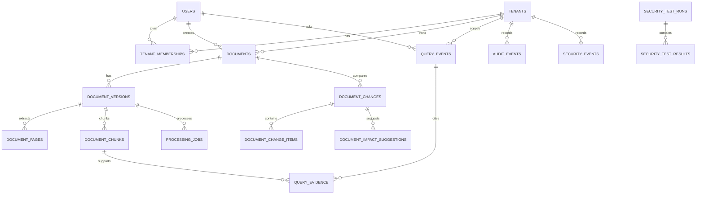

# NEXUS — PostgreSQL Database Schema

**Purpose:** Define the relational data model for tenant isolation, users/roles, documents and versions, Knowledge Change Intelligence, RAG evidence and security audit.  
**Database:** PostgreSQL  
**Migration approach:** SQLAlchemy 2.x models + Alembic migrations (recommended). The SQL below is a reference baseline; implement migrations and tests rather than relying on ad-hoc production table creation.

---

## 1. Data-model principles

- PostgreSQL is authoritative for tenant membership, document lifecycle and active-version state.
- Every tenant-owned table carries `tenant_id` so tenant scope can be checked explicitly and indexed.
- Composite foreign keys are used where practical to prevent cross-tenant references between documents, versions, chunks and evidence.
- A logical document can have many immutable versions, but no more than one `ACTIVE` version at a time.
- Candidate versions are processed and indexed before approval. Failed/rejected candidates never replace the current active version.
- ChromaDB stores vector search data. PostgreSQL stores stable identifiers and enough chunk/evidence metadata to validate access and rebuild the vector index.
- Query evidence stores a snapshot or immutable hash/reference of what was actually supplied to the LLM. Historical query records must not be rewritten when documents change.
- Store password hashes, never plaintext passwords. Do not store access tokens or API secrets in audit metadata.

## 2. Entity relationship overview



## 3. Enumerations

Use PostgreSQL enums or validated text fields consistently. Text + CHECK constraints are easier to evolve in early hackathon migrations; the following values are the intended contract.

- `tenant_status`: `ACTIVE`, `SUSPENDED`, `ARCHIVED`
- `user_status`: `ACTIVE`, `INVITED`, `SUSPENDED`, `DISABLED`
- `platform_role`: `USER`, `PLATFORM_ADMIN`
- `membership_role`: `CLIENT_ADMIN`, `EMPLOYEE`
- `membership_status`: `ACTIVE`, `INVITED`, `SUSPENDED`
- `document_version_status`: `UPLOADED`, `QUARANTINED`, `PROCESSING`, `REVIEW`, `ACTIVE`, `SUPERSEDED`, `FAILED`, `REJECTED`
- `processing_status`: `QUEUED`, `RUNNING`, `SUCCEEDED`, `FAILED`, `CANCELLED`
- `change_status`: `PENDING_REVIEW`, `APPROVED`, `REJECTED`, `FAILED`
- `change_type`: `ADDITION`, `REMOVAL`, `MODIFICATION`
- `impact_review_status`: `PENDING`, `CONFIRMED`, `REJECTED`
- `query_status`: `ANSWERED`, `INSUFFICIENT_EVIDENCE`, `CONFLICT`, `ERROR`
- `security_severity`: `INFO`, `LOW`, `MEDIUM`, `HIGH`, `CRITICAL`

## 4. Reference SQL DDL

The schema uses UUIDs generated by the application or `gen_random_uuid()`. If the database role cannot create extensions, UUIDs can be generated in the application instead.

```sql
CREATE EXTENSION IF NOT EXISTS pgcrypto;

CREATE TABLE tenants (
    id              uuid PRIMARY KEY DEFAULT gen_random_uuid(),
    slug            varchar(80) NOT NULL UNIQUE,
    name            varchar(200) NOT NULL,
    status          varchar(20) NOT NULL DEFAULT 'ACTIVE'
                    CHECK (status IN ('ACTIVE','SUSPENDED','ARCHIVED')),
    created_at      timestamptz NOT NULL DEFAULT now(),
    updated_at      timestamptz NOT NULL DEFAULT now()
);

CREATE TABLE users (
    id              uuid PRIMARY KEY DEFAULT gen_random_uuid(),
    email           varchar(320) NOT NULL UNIQUE,
    display_name    varchar(160) NOT NULL,
    password_hash   text NOT NULL,
    platform_role   varchar(30) NOT NULL DEFAULT 'USER'
                    CHECK (platform_role IN ('USER','PLATFORM_ADMIN')),
    status          varchar(20) NOT NULL DEFAULT 'ACTIVE'
                    CHECK (status IN ('ACTIVE','INVITED','SUSPENDED','DISABLED')),
    last_login_at   timestamptz,
    created_at      timestamptz NOT NULL DEFAULT now(),
    updated_at      timestamptz NOT NULL DEFAULT now()
);

CREATE TABLE tenant_memberships (
    id                          uuid PRIMARY KEY DEFAULT gen_random_uuid(),
    tenant_id                   uuid NOT NULL REFERENCES tenants(id),
    user_id                     uuid NOT NULL REFERENCES users(id),
    role                        varchar(30) NOT NULL CHECK (role IN ('CLIENT_ADMIN','EMPLOYEE')),
    status                      varchar(20) NOT NULL DEFAULT 'ACTIVE'
                                CHECK (status IN ('ACTIVE','INVITED','SUSPENDED')),
    last_permission_change_at   timestamptz NOT NULL DEFAULT now(),
    created_at                  timestamptz NOT NULL DEFAULT now(),
    updated_at                  timestamptz NOT NULL DEFAULT now(),
    UNIQUE (tenant_id, user_id),
    UNIQUE (tenant_id, id)
);
CREATE INDEX ix_memberships_user_status ON tenant_memberships(user_id, status);

CREATE TABLE documents (
    id              uuid PRIMARY KEY DEFAULT gen_random_uuid(),
    tenant_id       uuid NOT NULL REFERENCES tenants(id),
    title           varchar(300) NOT NULL,
    category        varchar(100),
    description     text,
    external_ref    varchar(200),
    authority_level varchar(50) NOT NULL DEFAULT 'OFFICIAL_POLICY'
                    CHECK (authority_level IN ('OFFICIAL_POLICY','STANDARD_PROCEDURE','GUIDELINE','INFORMAL_NOTE')),
    effective_date  date,
    created_by      uuid NOT NULL REFERENCES users(id),
    created_at      timestamptz NOT NULL DEFAULT now(),
    updated_at      timestamptz NOT NULL DEFAULT now(),
    UNIQUE (tenant_id, id),
    UNIQUE (tenant_id, external_ref)
);
CREATE INDEX ix_documents_tenant_updated ON documents(tenant_id, updated_at DESC);

CREATE TABLE document_versions (
    id                  uuid PRIMARY KEY DEFAULT gen_random_uuid(),
    tenant_id           uuid NOT NULL,
    document_id         uuid NOT NULL,
    version_number      integer NOT NULL CHECK (version_number > 0),
    original_filename   varchar(500) NOT NULL,
    storage_key         text NOT NULL UNIQUE,
    sha256              char(64) NOT NULL,
    mime_type           varchar(150) NOT NULL,
    file_size_bytes     bigint NOT NULL CHECK (file_size_bytes >= 0),
    status              varchar(20) NOT NULL DEFAULT 'UPLOADED'
                        CHECK (status IN ('UPLOADED','QUARANTINED','PROCESSING','REVIEW','ACTIVE','SUPERSEDED','FAILED','REJECTED')),
    quality_score       numeric(5,4),
    ocr_needed          boolean NOT NULL DEFAULT false,
    quality_report      jsonb NOT NULL DEFAULT '{}'::jsonb,
    is_conflicting      boolean NOT NULL DEFAULT false,
    conflict_notes      text,
    uploaded_by         uuid NOT NULL REFERENCES users(id),
    error_code          varchar(100),
    error_message       text,
    uploaded_at         timestamptz NOT NULL DEFAULT now(),
    processed_at        timestamptz,
    reviewed_at         timestamptz,
    activated_at        timestamptz,
    UNIQUE (document_id, version_number),
    UNIQUE (tenant_id, id),
    FOREIGN KEY (tenant_id, document_id) REFERENCES documents(tenant_id, id)
);
CREATE UNIQUE INDEX uq_one_active_version_per_document
    ON document_versions(document_id) WHERE status = 'ACTIVE';
CREATE INDEX ix_doc_versions_tenant_doc ON document_versions(tenant_id, document_id, version_number DESC);
CREATE INDEX ix_doc_versions_tenant_status ON document_versions(tenant_id, status);

CREATE TABLE processing_jobs (
    id              uuid PRIMARY KEY DEFAULT gen_random_uuid(),
    tenant_id       uuid NOT NULL,
    version_id      uuid NOT NULL,
    status          varchar(20) NOT NULL DEFAULT 'QUEUED'
                    CHECK (status IN ('QUEUED','RUNNING','SUCCEEDED','FAILED','CANCELLED')),
    stage           varchar(50),
    attempt_count   integer NOT NULL DEFAULT 0 CHECK (attempt_count >= 0),
    quality_metrics jsonb NOT NULL DEFAULT '{}'::jsonb,
    error_code      varchar(100),
    error_message   text,
    created_at      timestamptz NOT NULL DEFAULT now(),
    started_at      timestamptz,
    completed_at    timestamptz,
    FOREIGN KEY (tenant_id, version_id) REFERENCES document_versions(tenant_id, id)
);
CREATE INDEX ix_processing_jobs_tenant_status ON processing_jobs(tenant_id, status, created_at);

CREATE TABLE document_pages (
    tenant_id       uuid NOT NULL,
    version_id      uuid NOT NULL,
    page_number     integer NOT NULL CHECK (page_number > 0),
    extracted_text  text NOT NULL,
    text_sha256     char(64) NOT NULL,
    created_at      timestamptz NOT NULL DEFAULT now(),
    PRIMARY KEY (version_id, page_number),
    FOREIGN KEY (tenant_id, version_id) REFERENCES document_versions(tenant_id, id)
);
CREATE INDEX ix_document_pages_tenant_version ON document_pages(tenant_id, version_id);

CREATE TABLE document_chunks (
    id              uuid PRIMARY KEY DEFAULT gen_random_uuid(),
    tenant_id       uuid NOT NULL,
    version_id      uuid NOT NULL,
    chunk_index     integer NOT NULL CHECK (chunk_index >= 0),
    page_start      integer NOT NULL CHECK (page_start > 0),
    page_end        integer NOT NULL CHECK (page_end >= page_start),
    section_heading varchar(500),
    chunk_text      text NOT NULL,
    text_sha256     char(64) NOT NULL,
    embedding_model varchar(200) NOT NULL,
    vector_id       varchar(100) NOT NULL,
    allowed_roles   varchar(200) NOT NULL DEFAULT 'EMPLOYEE,CLIENT_ADMIN',
    classification  varchar(50) NOT NULL DEFAULT 'INTERNAL',
    created_at      timestamptz NOT NULL DEFAULT now(),
    UNIQUE (version_id, chunk_index),
    UNIQUE (tenant_id, id),
    FOREIGN KEY (tenant_id, version_id) REFERENCES document_versions(tenant_id, id)
);
CREATE INDEX ix_chunks_tenant_version ON document_chunks(tenant_id, version_id);
CREATE INDEX ix_chunks_version_page ON document_chunks(version_id, page_start, page_end);

CREATE TABLE document_changes (
    id                  uuid PRIMARY KEY DEFAULT gen_random_uuid(),
    tenant_id           uuid NOT NULL,
    document_id         uuid NOT NULL,
    from_version_id     uuid,
    to_version_id       uuid NOT NULL,
    status              varchar(20) NOT NULL DEFAULT 'PENDING_REVIEW'
                        CHECK (status IN ('PENDING_REVIEW','APPROVED','REJECTED','FAILED')),
    summary             text,
    summary_model       varchar(200),
    created_by          uuid NOT NULL REFERENCES users(id),
    reviewed_by         uuid REFERENCES users(id),
    created_at          timestamptz NOT NULL DEFAULT now(),
    reviewed_at         timestamptz,
    UNIQUE (document_id, from_version_id, to_version_id),
    UNIQUE (tenant_id, id),
    FOREIGN KEY (tenant_id, document_id) REFERENCES documents(tenant_id, id),
    FOREIGN KEY (tenant_id, from_version_id) REFERENCES document_versions(tenant_id, id),
    FOREIGN KEY (tenant_id, to_version_id) REFERENCES document_versions(tenant_id, id)
);
CREATE INDEX ix_document_changes_tenant_status ON document_changes(tenant_id, status, created_at DESC);

CREATE TABLE document_change_items (
    id                  uuid PRIMARY KEY DEFAULT gen_random_uuid(),
    tenant_id           uuid NOT NULL,
    change_id           uuid NOT NULL,
    change_type         varchar(20) NOT NULL CHECK (change_type IN ('ADDITION','REMOVAL','MODIFICATION')),
    section_heading     varchar(500),
    old_text            text,
    new_text            text,
    old_page            integer CHECK (old_page IS NULL OR old_page > 0),
    new_page            integer CHECK (new_page IS NULL OR new_page > 0),
    classification      varchar(50),
    confidence          numeric(5,4) CHECK (confidence IS NULL OR (confidence >= 0 AND confidence <= 1)),
    created_at          timestamptz NOT NULL DEFAULT now(),
    FOREIGN KEY (tenant_id, change_id) REFERENCES document_changes(tenant_id, id)
);
CREATE INDEX ix_change_items_change ON document_change_items(tenant_id, change_id);

CREATE TABLE document_impact_suggestions (
    id                      uuid PRIMARY KEY DEFAULT gen_random_uuid(),
    tenant_id               uuid NOT NULL,
    change_id               uuid NOT NULL,
    related_document_id     uuid NOT NULL,
    related_version_id      uuid,
    rationale               text NOT NULL,
    basis                   varchar(40) NOT NULL DEFAULT 'KEYWORD'
                            CHECK (basis IN ('EXPLICIT_REFERENCE','METADATA','KEYWORD','SEMANTIC','HUMAN')),
    review_status           varchar(20) NOT NULL DEFAULT 'PENDING'
                            CHECK (review_status IN ('PENDING','CONFIRMED','REJECTED')),
    reviewed_by             uuid REFERENCES users(id),
    reviewed_at             timestamptz,
    created_at              timestamptz NOT NULL DEFAULT now(),
    FOREIGN KEY (tenant_id, change_id) REFERENCES document_changes(tenant_id, id),
    FOREIGN KEY (tenant_id, related_document_id) REFERENCES documents(tenant_id, id),
    FOREIGN KEY (tenant_id, related_version_id) REFERENCES document_versions(tenant_id, id)
);
CREATE INDEX ix_impacts_tenant_status ON document_impact_suggestions(tenant_id, review_status, created_at DESC);

CREATE TABLE query_events (
    id                  uuid PRIMARY KEY DEFAULT gen_random_uuid(),
    tenant_id           uuid NOT NULL REFERENCES tenants(id),
    user_id             uuid NOT NULL REFERENCES users(id),
    question_text       text NOT NULL,
    answer_text         text,
    status              varchar(30) NOT NULL
                        CHECK (status IN ('ANSWERED','INSUFFICIENT_EVIDENCE','CONFLICT','ERROR')),
    grounding_verified  boolean NOT NULL DEFAULT true,
    grounding_score     numeric(5,4),
    model_name          varchar(200),
    model_version       varchar(100),
    embedding_model     varchar(200),
    prompt_version      varchar(100),
    latency_ms          integer CHECK (latency_ms IS NULL OR latency_ms >= 0),
    trace_stages        jsonb NOT NULL DEFAULT '[]'::jsonb,
    request_id          varchar(100),
    created_at          timestamptz NOT NULL DEFAULT now(),
    UNIQUE (tenant_id, id)
);
CREATE INDEX ix_query_events_tenant_created ON query_events(tenant_id, created_at DESC);
CREATE INDEX ix_query_events_user_created ON query_events(tenant_id, user_id, created_at DESC);

CREATE TABLE query_evidence (
    id                      uuid PRIMARY KEY DEFAULT gen_random_uuid(),
    tenant_id               uuid NOT NULL,
    query_id                uuid NOT NULL,
    chunk_id                uuid,
    version_id              uuid NOT NULL,
    page_start              integer NOT NULL CHECK (page_start > 0),
    page_end                integer NOT NULL CHECK (page_end >= page_start),
    claim_text              text,
    claim_supported         boolean NOT NULL DEFAULT true,
    evidence_text_snapshot  text NOT NULL,
    content_sha256          char(64) NOT NULL,
    retrieval_rank          integer NOT NULL CHECK (retrieval_rank > 0),
    retrieval_score         double precision,
    created_at              timestamptz NOT NULL DEFAULT now(),
    FOREIGN KEY (tenant_id, query_id) REFERENCES query_events(tenant_id, id),
    FOREIGN KEY (tenant_id, chunk_id) REFERENCES document_chunks(tenant_id, id),
    FOREIGN KEY (tenant_id, version_id) REFERENCES document_versions(tenant_id, id)
);
CREATE INDEX ix_query_evidence_query ON query_evidence(tenant_id, query_id);

CREATE TABLE audit_events (
    id              uuid PRIMARY KEY DEFAULT gen_random_uuid(),
    tenant_id       uuid REFERENCES tenants(id),
    actor_user_id   uuid REFERENCES users(id),
    action          varchar(100) NOT NULL,
    resource_type   varchar(100),
    resource_id     uuid,
    outcome         varchar(30) NOT NULL DEFAULT 'SUCCESS',
    request_id      varchar(100),
    metadata        jsonb NOT NULL DEFAULT '{}'::jsonb,
    created_at      timestamptz NOT NULL DEFAULT now()
);
CREATE INDEX ix_audit_tenant_created ON audit_events(tenant_id, created_at DESC);
CREATE INDEX ix_audit_actor_created ON audit_events(actor_user_id, created_at DESC);
CREATE INDEX ix_audit_action_created ON audit_events(action, created_at DESC);

CREATE TABLE security_events (
    id              uuid PRIMARY KEY DEFAULT gen_random_uuid(),
    tenant_id       uuid REFERENCES tenants(id),
    actor_user_id   uuid REFERENCES users(id),
    event_type      varchar(100) NOT NULL,
    severity        varchar(20) NOT NULL CHECK (severity IN ('INFO','LOW','MEDIUM','HIGH','CRITICAL')),
    outcome         varchar(30) NOT NULL,
    request_id      varchar(100),
    metadata        jsonb NOT NULL DEFAULT '{}'::jsonb,
    created_at      timestamptz NOT NULL DEFAULT now()
);
CREATE INDEX ix_security_events_tenant_created ON security_events(tenant_id, created_at DESC);

CREATE TABLE security_test_runs (
    id              uuid PRIMARY KEY DEFAULT gen_random_uuid(),
    started_by      uuid REFERENCES users(id),
    tenant_id       uuid REFERENCES tenants(id),
    suite_name      varchar(200) NOT NULL,
    status          varchar(20) NOT NULL CHECK (status IN ('RUNNING','PASSED','FAILED','ERROR')),
    summary         jsonb NOT NULL DEFAULT '{}'::jsonb,
    started_at      timestamptz NOT NULL DEFAULT now(),
    completed_at    timestamptz
);

CREATE TABLE security_test_results (
    id                  uuid PRIMARY KEY DEFAULT gen_random_uuid(),
    run_id              uuid NOT NULL REFERENCES security_test_runs(id),
    test_key            varchar(100) NOT NULL,
    title               varchar(250) NOT NULL,
    expected_result     text NOT NULL,
    actual_result       text,
    passed              boolean NOT NULL,
    severity            varchar(20) NOT NULL CHECK (severity IN ('INFO','LOW','MEDIUM','HIGH','CRITICAL')),
    evidence_redacted   jsonb NOT NULL DEFAULT '{}'::jsonb,
    created_at          timestamptz NOT NULL DEFAULT now(),
    UNIQUE (run_id, test_key)
);
```

## 5. Important constraints and transaction rules

### 5.1 One active version per document

The partial unique index `uq_one_active_version_per_document` enforces at most one `ACTIVE` version for a document. To publish a candidate:

```sql
BEGIN;

-- Application has already checked user membership and CLIENT_ADMIN role.
-- Lock the logical document to serialise two simultaneous approvals.
SELECT id
FROM documents
WHERE tenant_id = :tenant_id AND id = :document_id
FOR UPDATE;

-- Confirm candidate belongs to the same tenant/document and is REVIEW.
-- Confirm it has completed validation, extraction and indexing.

UPDATE document_versions
SET status = 'SUPERSEDED'
WHERE tenant_id = :tenant_id
  AND document_id = :document_id
  AND status = 'ACTIVE';

UPDATE document_versions
SET status = 'ACTIVE', reviewed_at = now(), activated_at = now()
WHERE tenant_id = :tenant_id
  AND document_id = :document_id
  AND id = :candidate_version_id
  AND status = 'REVIEW';

-- Application must assert exactly one candidate row was updated.
INSERT INTO audit_events (...);

COMMIT;
```

If any check or update fails, roll back. The previous active version must remain active if the candidate is not ready. Add an application/service test for concurrent approval attempts.

### 5.2 Tenant-safe relationships

Always include `tenant_id` in repository queries for tenant data. Use composite foreign keys for same-tenant relationships as shown. Do not fetch a resource by UUID alone and assume possession of the identifier grants access.

### 5.3 Active-version retrieval

The retrieval service must join candidate chunk IDs back to PostgreSQL and require:

- `document_chunks.tenant_id = authorised_tenant_id`
- `document_versions.tenant_id = authorised_tenant_id`
- `document_versions.status = 'ACTIVE'`

A Chroma metadata field such as `is_active=true` can improve retrieval efficiency but cannot replace this database validation. Never send stale/superseded evidence to the LLM.

## 6. PostgreSQL Row-Level Security (defence-in-depth)

RLS is recommended where it can be configured and tested correctly. Example policy for a tenant-owned table:

```sql
ALTER TABLE documents ENABLE ROW LEVEL SECURITY;
ALTER TABLE documents FORCE ROW LEVEL SECURITY;

CREATE POLICY documents_tenant_isolation
ON documents
USING (tenant_id = NULLIF(current_setting('app.tenant_id', true), '')::uuid)
WITH CHECK (tenant_id = NULLIF(current_setting('app.tenant_id', true), '')::uuid);
```

At the beginning of each tenant-scoped database transaction, set the context transaction-locally:

```sql
SELECT set_config('app.tenant_id', :tenant_id::text, true);
```

Important:

- Use a dedicated application database role that is not a superuser and does not have `BYPASSRLS`.
- `FORCE ROW LEVEL SECURITY` does not constrain superusers or roles with `BYPASSRLS`.
- Ensure every access path uses the transaction context correctly; connection pooling must not leak tenant context across requests.
- Apply and test RLS consistently for all tenant-owned tables, not just `documents`.
- Keep explicit repository tenant filters even when RLS is enabled.
- Do not claim RLS protection until tests demonstrate it under the actual application database role.

If RLS cannot be safely completed during the 24-hour MVP, implement explicit tenant-scoped repositories/dependencies first, document RLS as a hardening task, and do not imply it is active.

## 7. ChromaDB mapping

Recommended MVP mapping:

- One collection per tenant, named from a server-generated tenant UUID (for example `nexus_t_<uuid_without_hyphens>`).
- Store each vector with metadata: `tenant_id`, `document_id`, `version_id`, `chunk_id`, `page_start`, `page_end`, `content_sha256`, `embedding_model`.
- The backend maps the authorised tenant to the collection. The client never supplies the collection name.
- Store the actual chunk text and authoritative status in PostgreSQL. Chroma returns candidate chunk IDs/scores; PostgreSQL verifies ownership and active status and provides the text used for generation.
- Keep Chroma private to the application/worker network.
- Add a reindex command that rebuilds one tenant collection from PostgreSQL chunk records and the configured embedding model.

For stricter production isolation, evaluate separate vector DB instances or deployments per high-assurance tenant. A collection name is a logical partition, not by itself a hardened security boundary.

## 8. Suggested SQLAlchemy model modules

```text
backend/app/models/
  tenant.py
  user.py
  membership.py
  document.py
  document_version.py
  processing_job.py
  document_page.py
  document_chunk.py
  document_change.py
  query_event.py
  audit_event.py
  security_event.py
```

Keep enums/constants in a shared module. Use UUID primary keys, timezone-aware timestamps, explicit indexes and Alembic migrations. Use repository/service functions that require an explicit authorised tenant context.

## 9. Data retention and privacy notes

- Agree with VLOOKUP on retention periods before importing real client records.
- Avoid storing sensitive full document text in application logs.
- Query text and answer content may themselves be confidential; restrict evidence history to authorised roles.
- Define tenant offboarding and deletion workflows, including originals, extracted text, chunks, embeddings, backups and audit retention exceptions.
- Keep backups encrypted and test restoration.
- Do not use client documents to train or fine-tune a model unless explicitly authorised under a separate agreement.

## 10. Schema acceptance checklist

- [ ] A user can belong to multiple tenants through memberships.
- [ ] A user cannot access a tenant without an active membership (unless explicitly authorised platform-admin workflow is used and audited).
- [ ] Same-tenant composite foreign keys reject cross-tenant document/version/chunk references.
- [ ] At most one document version can be `ACTIVE`.
- [ ] A candidate cannot become active unless it has completed processing/indexing and an authorised admin approves it.
- [ ] A failed candidate leaves the prior active version unchanged.
- [ ] Superseded versions remain available to authorised audit/history views but not normal RAG retrieval.
- [ ] Query evidence records exact version/page/chunk provenance.
- [ ] Audit and security events can be retrieved only by authorised users.
- [ ] Chroma can be rebuilt from persisted chunk records.
- [ ] Migrations run from an empty database and upgrade an existing database successfully.
