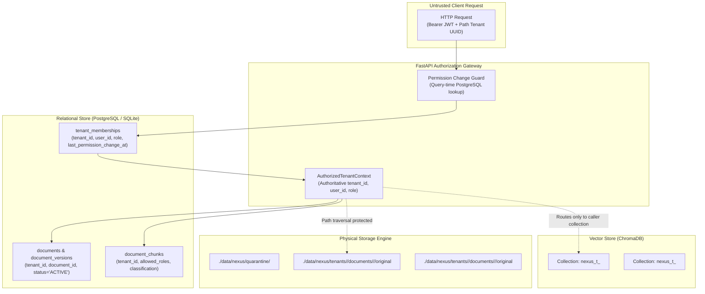
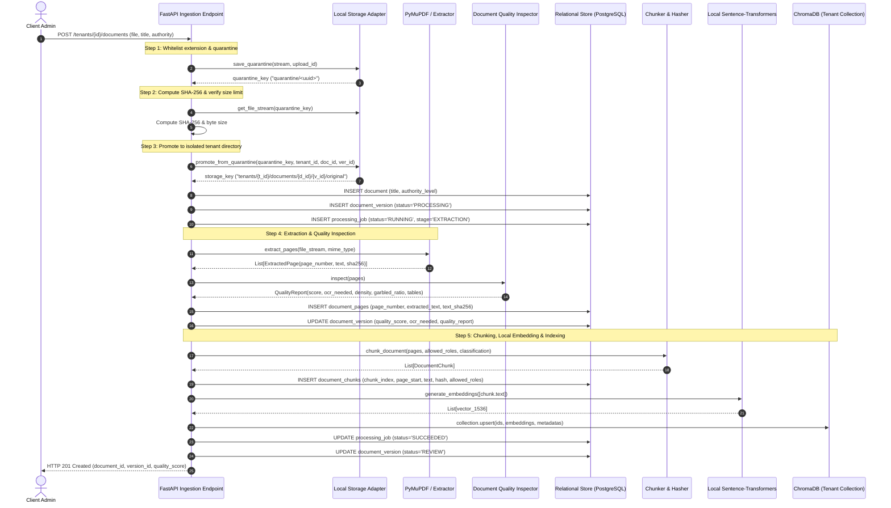
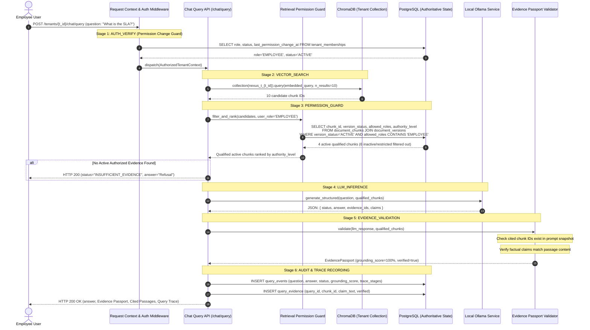
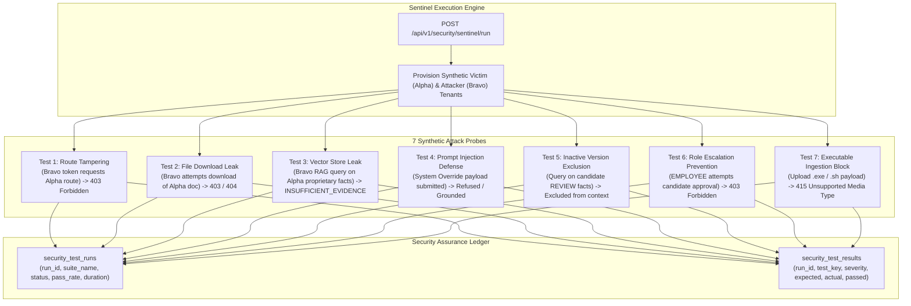

# NEXUS — Data Flow & Pipeline Architecture

This document specifies the end-to-end data flows, lifecycle boundaries, storage partitioning, and pipeline execution sequences across the NEXUS platform.

---

## 1. Multi-Tenant Storage & Isolation Boundaries

NEXUS enforces strict tenant isolation across three separate storage tiers: relational state, vector collections, and physical filesystem storage. No tier trusts client-provided identifiers.



---

## 2. Document Ingestion & Quality Inspection Data Flow

When a Client Administrator uploads a document (PDF, DOCX, or TXT), it progresses through a strict five-stage pipeline before entering the review stage.



---

## 3. Knowledge Change Intelligence & Approval Data Flow

When a new version (v2) of an existing policy document is uploaded, it is compared against the prior active version using deterministic clause diffing. Activation is gated on explicit human approval.

```mermaid
sequenceDiagram
    autonumber
    actor Admin as Client Admin
    participant API as Documents / Versions API
    participant Diff as Change Intelligence Engine
    participant DB as Relational Store (PostgreSQL)

    Admin->>API: GET /tenants/{t_id}/documents/{d_id}/changes?to_version_id={v2}
    API->>DB: SELECT document_pages WHERE version_id IN (v1, v2)
    DB-->>API: v1_pages, v2_pages
    API->>Diff: compute_version_diff(v1, v2)
    Note over Diff: SequenceMatcher segment-by-segment comparison
    Note over Diff: Classify policy clauses (SLA, FINANCIAL, GOVERNANCE)
    Note over Diff: Scan other active docs for impact notices
    Diff->>DB: INSERT document_changes (status='PENDING_REVIEW')
    Diff->>DB: INSERT document_change_items (ADDITION, REMOVAL, MODIFICATION)
    Diff->>DB: INSERT document_impact_suggestions (related_doc_id, rationale)
    Diff-->>API: VersionDiffReport
    API-->>Admin: HTTP 200 OK (diff report, clause highlights, impact notices)

    opt Human Rejection
        Admin->>API: POST /tenants/{t_id}/versions/{v2}/reject
        API->>DB: UPDATE document_versions SET status='FAILED' WHERE id=v2
        API->>DB: UPDATE document_changes SET status='REJECTED'
        API->>DB: INSERT audit_events (action='DOCUMENT_VERSION_REJECTED')
        API-->>Admin: HTTP 200 OK (Version 2 rejected; v1 remains ACTIVE)
    end

    opt Human Approval (Atomic Transaction)
        Admin->>API: POST /tenants/{t_id}/versions/{v2}/approve
        Note over API,DB: Begin Transaction with Row Lock
        API->>DB: SELECT * FROM documents WHERE id=d_id FOR UPDATE
        API->>DB: UPDATE document_versions SET status='SUPERSEDED' WHERE status='ACTIVE'
        API->>DB: flush()
        API->>DB: UPDATE document_versions SET status='ACTIVE' WHERE id=v2
        API->>DB: flush() (Enforces partial unique index)
        API->>DB: UPDATE document_changes SET status='APPROVED', reviewed_by=user_id
        API->>DB: INSERT audit_events (action='DOCUMENT_VERSION_APPROVED')
        API->>DB: commit()
        API-->>Admin: HTTP 200 OK (Version 2 is now ACTIVE; v1 is SUPERSEDED)
    end
```

---

## 4. Secure Grounded RAG Query & Evidence Passport Data Flow

This data flow details how a user question is answered with verifiable grounding while enforcing Permission Change Guard and generating observable Query Trace diagnostics.



---

## 5. Query Trace Observable Execution Sequence

For every query execution, NEXUS emits an immutable `QueryTrace` capturing the latency and decisions across all six pipeline stages:

```json
{
  "trace_id": "qt-6f34e89a-0a2b-4d43-98fe-892418a0bfb2",
  "query_id": "q-884bc19e-f412-4cf5-99bc-2305a4ecb901",
  "total_latency_ms": 142,
  "stages": [
    {
      "stage": "AUTH_VERIFY",
      "status": "PASSED",
      "duration_ms": 3,
      "detail": "Verified active membership in tenant Alpha (role=EMPLOYEE)"
    },
    {
      "stage": "VECTOR_SEARCH",
      "status": "PASSED",
      "duration_ms": 32,
      "detail": "Retrieved 10 candidate chunks from Chroma collection nexus_t_tenant-a"
    },
    {
      "stage": "PERMISSION_GUARD",
      "status": "PASSED",
      "duration_ms": 11,
      "detail": "PostgreSQL verified 4 chunks active; filtered 6 candidate chunks (inactive version / role clearance)"
    },
    {
      "stage": "INTEGRITY_CHECK",
      "status": "PASSED",
      "duration_ms": 2,
      "detail": "Knowledge integrity verified: top authority OFFICIAL_POLICY; no multi-source conflicts detected"
    },
    {
      "stage": "LLM_INFERENCE",
      "status": "PASSED",
      "duration_ms": 86,
      "detail": "Local synthesis generated structured answer with 1 grounded claim"
    },
    {
      "stage": "EVIDENCE_VALIDATION",
      "status": "PASSED",
      "duration_ms": 8,
      "detail": "Evidence Passport issued: 100% citations verified against prompt snapshot"
    }
  ]
}
```

---

## 6. Red-Team Sentinel Adversarial Testing Data Flow

The Red-Team Sentinel runner executes synthetic adversarial tests against multi-tenant boundaries on-demand or as part of continuous regression testing.



