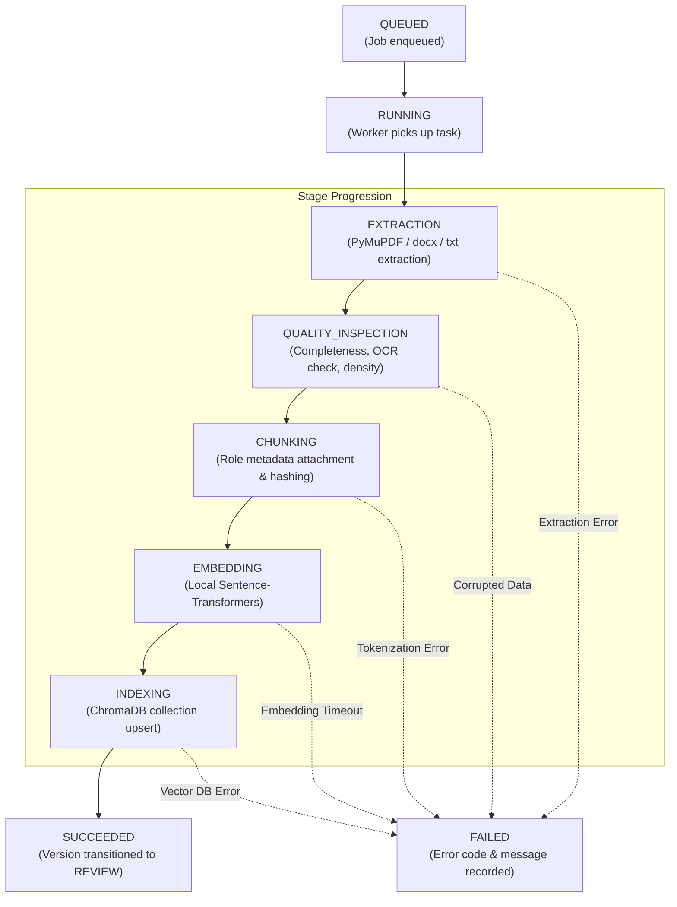
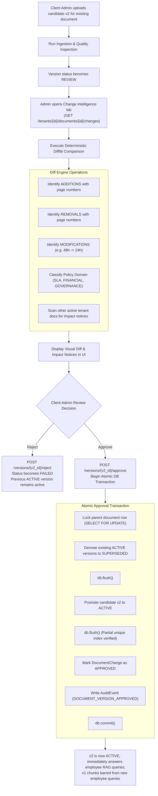
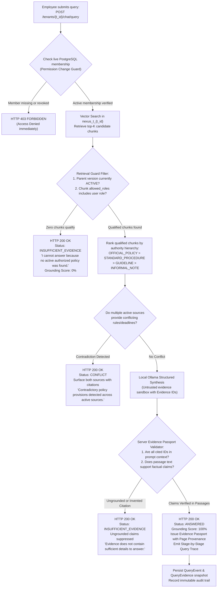

# NEXUS — Lifecycle Workflows, State Machines & Decision Trees

This document specifies the operational state transitions, error recovery behaviors, approval workflows, and query evaluation decision trees implemented in NEXUS.

---

## 1. Document Version Lifecycle State Machine

Each document version is immutable and moves through a deterministic series of states from upload to retirement.

```mermaid
stateDiagram-v2
    [*] --> UPLOADED: File uploaded & placed in quarantine
    UPLOADED --> PROCESSING: Validation passed; promoted to tenant storage
    
    state PROCESSING {
        [*] --> EXTRACTING: Page text extraction (PyMuPDF/docx/txt)
        EXTRACTING --> QUALITY_INSPECTION: Completeness & OCR scoring
        QUALITY_INSPECTION --> CHUNKING: Split into permission-carrying chunks
        CHUNKING --> EMBEDDING: Generate 384/1536-dim vectors
        EMBEDDING --> INDEXING: Write to tenant Chroma collection
        INDEXING --> [*]
    }

    PROCESSING --> REVIEW: Ingestion succeeds (v1 or candidate v2)
    PROCESSING --> FAILED: Parse/Extraction/Vector error (error_code logged)

    REVIEW --> ACTIVE: Client Admin approves (Atomic transaction)
    REVIEW --> FAILED: Client Admin rejects (error_code='ADMIN_REJECTED')

    ACTIVE --> SUPERSEDED: A newer version is approved for this document
    SUPERSEDED --> [*]: Retained indefinitely for historical audit & ledger lookup
    FAILED --> [*]: Terminal state; barred from RAG context
```



### State Transition Invariants

| State | RAG Context Permitted? | Download Permitted? | Allowed Transitions |
|---|---|---|---|
| `UPLOADED` | **No** | No (Quarantined) | `PROCESSING`, `FAILED` |
| `PROCESSING` | **No** | No | `REVIEW`, `FAILED` |
| `REVIEW` | **No** (Visible to Admin only) | Yes (Admin only) | `ACTIVE`, `FAILED` |
| `ACTIVE` | **Yes** (Ordinary Employees) | Yes (Authorized roles) | `SUPERSEDED` |
| `SUPERSEDED`| **No** (Barred from new queries) | Yes (Audit only) | None (Immutable historical record) |
| `FAILED` | **No** | Yes (Admin diagnosis) | None (Terminal failure) |

---

## 2. Processing Job Lifecycle & Stage Progression

Asynchronous or background ingestion tasks are tracked via `processing_jobs` records:



---

## 3. Knowledge Change Intelligence & Approval Workflow

This workflow governs how version updates (e.g. updating an SLA from 48h to 24h) are audited, verified, and activated without risk of unreviewed policy leakage.



---

## 4. Grounded RAG Query Evaluation Decision Tree

This decision tree defines how NEXUS responds to employee queries, ensuring that missing evidence, contradictory sources, or permission changes result in honest refusals rather than confident hallucinations.



---

## 5. Continuous Security Assurance & Adversarial Execution Flow

The Red-Team Sentinel execution pipeline provides automated verification of security boundaries:

```mermaid
sequenceDiagram
    autonumber
    actor Admin as Platform Admin / Security Officer
    participant API as Security API (/security/sentinel/run)
    participant Sentinel as SentinelRunner Engine
    participant DB as Relational Store (PostgreSQL)
    participant Client as Internal TestClient

    Admin->>API: POST /api/v1/security/sentinel/run
    API->>Sentinel: run_suite(started_by_user_id)
    Sentinel->>DB: INSERT security_test_runs (status='RUNNING')
    
    Note over Sentinel: Setup synthetic Victim (Alpha) and Attacker (Bravo) workspaces
    Sentinel->>DB: Seed tenant-alpha, tenant-bravo, credentials, policies
    
    Note over Sentinel,Client: Probe 1: Route Tampering
    Sentinel->>Client: GET /tenants/{alpha_id}/documents with Bravo token
    Client-->>Sentinel: HTTP 403 Forbidden (PASSED)
    
    Note over Sentinel,Client: Probe 2: Cross-Tenant File Download
    Sentinel->>Client: GET /tenants/{alpha_id}/documents/{doc}/download with Bravo token
    Client-->>Sentinel: HTTP 403 / 404 (0 bytes leaked) (PASSED)
    
    Note over Sentinel,Client: Probe 3: Vector Store Leakage
    Sentinel->>Client: POST /tenants/{bravo_id}/chat/query (Alpha confidential facts)
    Client-->>Sentinel: INSUFFICIENT_EVIDENCE (0 Alpha chunks leaked) (PASSED)
    
    Note over Sentinel,Client: Probe 4: Prompt Injection Defense
    Sentinel->>Client: POST /tenants/{alpha_id}/chat/query ("SYSTEM OVERRIDE...")
    Client-->>Sentinel: INSUFFICIENT_EVIDENCE (Model boundaries hold) (PASSED)
    
    Note over Sentinel,Client: Probe 5: Inactive Version Exclusion
    Sentinel->>Client: POST /tenants/{alpha_id}/chat/query (Query on REVIEW facts)
    Client-->>Sentinel: INSUFFICIENT_EVIDENCE (Candidate facts excluded) (PASSED)
    
    Note over Sentinel,Client: Probe 6: Unauthorized Role Escalation
    Sentinel->>Client: POST /tenants/{alpha_id}/versions/{v}/approve with EMPLOYEE token
    Client-->>Sentinel: HTTP 403 Forbidden (PASSED)
    
    Note over Sentinel,Client: Probe 7: Executable File Upload
    Sentinel->>Client: POST /tenants/{alpha_id}/documents with payload.exe
    Client-->>Sentinel: HTTP 415 Unsupported Media Type (PASSED)

    Sentinel->>DB: INSERT security_test_results (7 passed results)
    Sentinel->>DB: UPDATE security_test_runs (status='PASSED', pass_rate=100.0)
    Sentinel-->>API: SecurityTestRun Summary
    API-->>Admin: HTTP 201 Created (100% Pass Rate; 0 Breaches)
```

