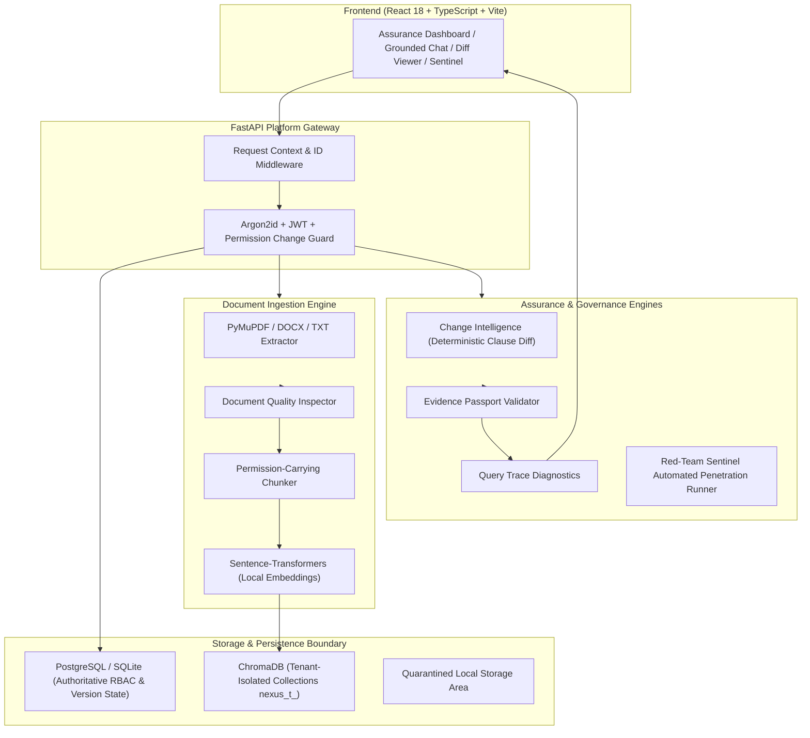

# NEXUS — Enterprise Knowledge Intelligence & Continuous Assurance Platform

[]()
[]()
[]()

NEXUS is an enterprise-grade multi-tenant knowledge intelligence and assurance platform designed to address the major security, operational, and reliability vulnerabilities that persist in modern enterprise RAG deployments (such as Microsoft Azure AI Search, AWS Bedrock, and Glean).

---

## The 6 Strategic Differentiation Pillars

| # | Pillar | Enterprise Failure in Standard RAG | NEXUS Architectural Solution |
|---|---|---|---|
| **1** | **Permission Change Guard** | ACL synchronization lag allows revoked users to access stale indexed chunks. | Authoritative PostgreSQL permission verification at query time. Any revoked user or demoted role is denied immediately without waiting for index crawls. |
| **2** | **Document Quality Inspector** | Silent extraction corruption, garbled text, and lost tables lead to flawed answers. | Pre-indexing evaluation scoring extraction completeness, garbled character ratios, table preservation, and OCR requirements before indexing. |
| **3** | **Evidence Passport** | LLMs hallucinate plausible claims even when supplied with relevant context. | Every factual statement is strictly bound to citations with page provenance. Factual claims without evidence trigger honest refusals. |
| **4** | **Knowledge Integrity Engine** | Older informal documents or circulars can contradict and pollute official policy answers. | Explicit policy authority hierarchy (`OFFICIAL_POLICY` > `STANDARD_PROCEDURE` > `GUIDELINE` > `INFORMAL_NOTE`) and contradiction detection across active documents. |
| **5** | **Knowledge Change Intelligence** | Policy changes (e.g. SLA 48h → 24h) silently overwrite or create split-brain states. | Deterministic passage-level diffs (`ADDITION`, `REMOVAL`, `MODIFICATION`) with page numbers, policy domain classifications (`SLA`, `FINANCIAL`, `GOVERNANCE`), and atomic activation transactions enforcing at most one `ACTIVE` version per document. |
| **6** | **Red-Team Sentinel & Query Trace** | Teams lack continuous automated proof that tenant boundaries and safety guardrails hold. | Automated continuous penetration testing against synthetic attacker/victim tenants verifying 7 attack scenarios, paired with stage-by-stage observable execution timelines (`QueryTrace`). |

---

## System Architecture



---

## Directory Layout

```
NEXUS/
├── ARCHITECTURE.md                 # Strategic positioning, specifications & data flows
├── DATABASE_SCHEMA.md              # Complete relational schema (17 tables & partial unique indexes)
├── IMPLEMENTATION_PLAN.md          # 24-hour vertical slice delivery & attack gates
├── docker-compose.yml              # Multi-container local orchestration
├── backend/
│   ├── app/
│   │   ├── api/v1/                 # REST endpoints: auth, tenants, documents, versions, chat, security
│   │   ├── core/                   # Strict settings, error envelope, JWT, argon2id hashing
│   │   ├── db/                     # Declarative Base and thread-safe session engines
│   │   ├── models/                 # 17 SQLAlchemy models
│   │   ├── schemas/                # Pydantic request/response validation schemas
│   │   └── services/
│   │       ├── authorization/      # Permission Change Guard context dependency
│   │       ├── change_intelligence/# Deterministic diffing & policy impact analysis
│   │       ├── embeddings/         # Sentence-Transformers with deterministic offline fallback
│   │       ├── evidence/           # Server-side claim validation & Evidence Passport issuance
│   │       ├── ingestion/          # Page extractor, Document Quality Inspector & chunker
│   │       ├── llm/                # Ollama integration with deterministic grounded synthesis
│   │       ├── security/           # Red-Team Sentinel automated attack runner
│   │       ├── storage/            # Quarantined tenant path storage adapter
│   │       └── vector_store/       # Isolated Chroma collection manager
│   ├── scripts/
│   │   └── seed.py                 # Seeds synthetic tenants, policies, versions & diffs
│   └── tests/
│       └── unit/                   # 35 comprehensive unit & adversarial test cases
└── frontend/
    ├── src/
    │   ├── components/             # Document Quality Modal, Diff Viewer, Passport, Query Trace, Sentinel
    │   ├── api.ts                  # Centralized typed API client
    │   ├── types.ts                # TypeScript domain contracts
    │   └── App.tsx                 # Enterprise Assurance dashboard with identity & workspace switcher
    └── package.json
```

---

## Quickstart Guide

### 1. Backend Setup & Run

```bash
# Navigate to backend directory
cd backend

# Activate Python virtual environment (Python 3.12+)
.\.venv\Scripts\Activate.ps1    # Windows PowerShell
# or: source .venv/bin/activate  # Linux / macOS

# Install dependencies
pip install -r requirements.txt

# Run initial database seed (provisions synthetic tenants, policies, versions & diffs)
python scripts/seed.py

# Launch FastAPI development server
uvicorn app.main:app --host 0.0.0.0 --port 8000 --reload
```

The API documentation will be available at `http://localhost:8000/docs`.

### 2. Frontend Setup & Run

```bash
# Navigate to frontend directory
cd frontend

# Install node dependencies
npm install

# Run Vite development server
npm run dev
# or build for production
npm run build
```

Open `http://localhost:5173` in your browser to access the NEXUS Enterprise Assurance Dashboard.

---

## Pre-Seeded Demonstration Personas

You can switch between simulated identities with one click directly inside the dashboard sidebar:

| Persona | Email | Password | Role | Workspace |
|---|---|---|---|---|
| **Alice Admin** | `admin@a.corp` | `NexusSecretPass123!` | `CLIENT_ADMIN` | Alpha Financial Services (`tenant-a`) |
| **Edward Employee** | `emp@a.corp` | `NexusSecretPass123!` | `EMPLOYEE` | Alpha Financial Services (`tenant-a`) |
| **Bob Admin** | `admin@b.corp` | `NexusSecretPass123!` | `CLIENT_ADMIN` | Beta Healthcare Systems (`tenant-b`) |
| **Platform Root** | `root@nexus.corp` | `NexusSecretPass123!` | `PLATFORM_ADMIN` | Global Platform |

---

## Running Automated Assurance Tests

NEXUS includes 35 comprehensive test cases covering tenant isolation, ingestion quality, grounded RAG, Knowledge Change Intelligence, and continuous penetration testing:

```bash
# Run full unit and security suite
pytest backend/tests/unit/ -v
```

### Verified Test Categories:
1. **Multi-Tenant Boundary:** Path tampering, cross-tenant file download denials, role escalations.
2. **Permission Change Guard:** Immediate revocation takes effect at query time without re-indexing.
3. **Document Quality Inspector:** Page text completeness, OCR detection, garbled ratio calculation.
4. **Knowledge Change Intelligence:** Deterministic diffs between v1 and v2, clause classifications, and atomic version activation.
5. **Evidence Passport & RAG:** Server-side citation verification, honest refusal for unsupported questions, multi-document contradiction detection.
6. **Red-Team Sentinel:** In-process penetration testing executing all 7 attack checks (100% pass rate).

